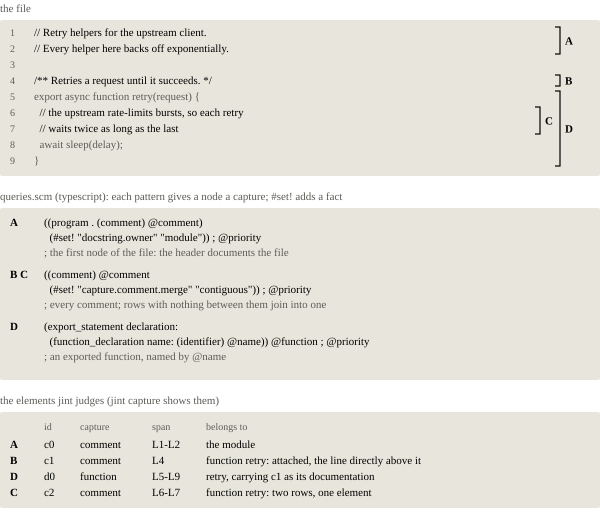

# Captures

jint uses Treesitter to turn a parsed file into elements, using a `queries.scm` file per language to capture the
elements that are needed for classification.

In Tree-sitter `.scm` query files, a capture labels a matched syntax node so editors or tools
can style, inspect, or transform it.

A rule names a [target](targets.md), and the target resolves to the elements of one or more captures.



A `#set!` line adds a fact about that capture. Here, pattern A makes the comment that opens the file
belong to the file. Pattern B C makes each comment an element and joins comment lines with nothing
between them, so lines 6 and 7 are one element. A comment directly above a definition, like line 4,
becomes that definition's documentation.

A pattern can also mark parts of the element it matches. The inner `@name` capture marks the name, and the inner `@body` capture marks where the body starts. The text of a definition before its `@body` node is its `signature`, which a custom rule can read. Write the field as `body: (_)? @body` so that a definition without a body, such as a prototype, still matches. A definition whose pattern marks no body has its first line as its signature.

## Check what a file yields

`jint capture` runs the extraction only. It makes no classifier calls, so it costs nothing.

```bash
jint capture src/cli.ts                    # one line per element: grammar, capture, span, name
jint capture src/cli.ts --json             # the element array as JSON
jint capture --rule is_cognitively_complex # mark the elements one rule will judge
jint capture src/a.ts --queries wip.scm    # extract with your own .scm instead of the grammar's
```

Run it before you calibrate a rule. A rule cannot find a defect in code that no element covers.

## Two kinds of capture

- **Shared captures** (`function`, `method`, `class`, `type`, `binding`, `comment`, `import`) form
  the vocabulary every grammar uses. A rule targets them by plural name, such as `functions`.
- **A grammar's own captures** belong to one grammar, such as `markdown:paragraph`. A rule targets
  them as `{grammar}:{capture}`.

## Add a capture

One pattern and one directive make a new element. This one captures the top-level loops and
conditionals of a Python script, so we can classify them.

```scheme
; extends
(module
  [(for_statement) (while_statement) (if_statement)] @statement_group
  (#set! "capture.statement_group.definition" "true")
  (#set! "capture.statement_group.merge" "adjacent")) ; @priority
```

By using the `; extends` statement, your patterns precede the default grammar's captures.

`; @priority` says the pattern order is deliberate. A pattern needs it when another pattern in your
file shares its root node type.

To try it, run:

```bash
jint capture main.py --queries extra.scm
```

To use it in a run, save it as `queries.scm` in `$JINT_GRAMMAR_DIR/python/` next to an `extensions.json`
such as `[".py"]` to signal jint what file extensions should this capture target.
Now, a rule can use the new custom capture as `python:statement_group`. See [BYOG](byog.md).

Other default directives set the element behavior: `opaque`, `merge` and `selfNesting`. See
[directives](directives.md).

Then run `jint capture` on files with the construct and files without it.
