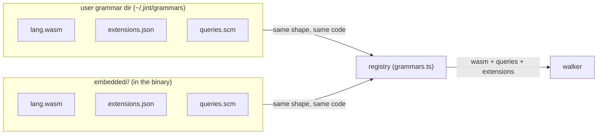
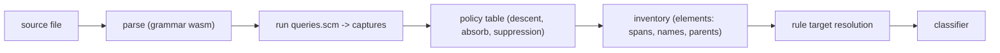

## What exists today

Nine grammars ship embedded in the binary: c, cpp, css, go, markdown, php, python, tsx,
typescript. Each lives in `packages/sdk/src/core/input/embedded/<id>/` - the DIRECTORY NAME is
the grammar id - as three artifacts: `<id>.wasm` (parse), `extensions.json` (routing: a bare
JSON array like [".md"]), `queries.scm` (extraction patterns + shape directives).
The walker (`walk.ts`) parses with web-tree-sitter, runs the grammar's compiled queries
(`query.ts`), and materializes the inventory. It holds no node-type names: the .scm assigns
captures, the runtime sees only captures.

A user grammar dir (`$JINT_GRAMMAR_DIR`, default `~/.jint/grammars`) registers at lint start
through the same shape - each SUBDIRECTORY is one grammar, its id the directory name; a user wasm wins over embedded for the same id, and a
queries.scm + extensions.json dir without a wasm shadows an embedded grammar's extraction. The registry table
(`grammars.ts`) is one line per grammar; the dirs stay pure data.

The parity corpora (`tests/fixtures/parity/`) pin the extraction per language; the ten-grammar
port and the dogfood run against main are complete. This branch IS the implementation.

## Decision

### Grammars are embedded and tool-owned (2026-10-14, embed verdict)

All ten grammars registered through the compile-time embedded path at the 2026-10-14 verdict
(nine today — verilog was removed, see the removal decision below). Size (linux-x64, gzip -9, the
release setting): four-grammar tar.gz 35.7 MB -> all-ten 36.9 MB, +1.25 MB (+3.3%) - raw delta
+24 MB, but wasms compress ~95% in the container. CI determinism buys the rest: the same commit
produces the same report, with no network, no registry, no version drift in the measurement path.

The why: the agent-authored field trials replaced the hypothetical bring-your-own-grammar user.
Ten real grammars went through trials, review rounds, and ported parity corpora; the vocabulary
grew through releases with two-language calibration (the is_filename_fitting precedent), never
by user minting. A user grammar dir stays the seam for the long tail, and it is the SAME three-file
shape as embedded - wasm + extensions.json + queries.scm - so the custom-grammar path exercises the
identical code the binary ships.

### Queries are the mapping (2026-10-15, query port)

The grammar's queries.scm IS the mapping - the nvim-treesitter tags.scm pattern. A pattern
captures a node with a jint-owned capture; the runtime turns matches into candidate elements. The
old declarative table's six adjustment fields collapse into pattern authoring plus one policy
table:

- **Span = captured node.** Absorb is pattern authoring: a wrapper that belongs to the element
  (ts export_statement, python decorated_definition, cpp template_declaration) is captured by the
  wrapper pattern. absorbTail (bytes of tail that still read as prefix-absorb: 2 for type and
  binding, swallowing a trailing `;`) is the only numeric policy.
- **Pattern order is priority.** Two patterns rooting on the same node type but assigning
  different captures resolve to the earlier pattern (c's prototype/state split depends on it).
  The validator demands an `; @priority` directive comment on every involved pattern; a pair
  without it fails the run at setup (SetupError naming the patterns and the fix).
- **Same-capture nesting is suppressed, outer wins** - a same-capture match inside an existing
  same-capture element reads as a wrapper's payload and collapses into it, unless the tail
  distance is real (a nested function with a body surfaces as a child). A selfNesting grammar
  (.scm #set! fact; markdown) disables the collapse entirely - sections nest legitimately.
- **Per-capture descent is a POLICY table**, keyed by the outer capture, in `query.ts` - no
  per-grammar overrides. The one grammar that needed a shape change (markdown, sections nest)
  expresses it IN the .scm as a `#set! "selfNesting"` directive beside the section pattern -
  shape directives are per-pattern facts, so they live per-pattern. Every other grammar ships
  zero-config.
- **Honest absence over stretch.** A node type with no honest home in the vocabulary is not
  force-mapped; it is recorded as WAITING in the .scm comments and the parity README. Stretches
  poison the classifier frame.

#### The capture -> target table

| capture    | rule-side targets                                     | descent policy                                                                 | absorbTail | notes                                                                                                                             |
| ---------- | ----------------------------------------------------- | ------------------------------------------------------------------------------ | ---------- | --------------------------------------------------------------------------------------------------------------------------------- |
| @function  | functions, definitions                                | opaque (nested same-capture units with real tail distance surface as children) | 0          | test call composites included via callee-predicated patterns (ts/tsx); free functions only                                        |
| @method    | methods, definitions                                  | function's shape (opaque)                                                      | 0          | member functions: ts/tsx method_definition, python class-body functions (context capture), go/php/cpp receivers and member shapes |
| @class     | classes, definitions                                  | type's shape (show-through interiors)                                          | 2          | class-like units: ts/tsx/python/php/cpp class declarations; anonymous classes unjudged                                            |
| @type      | types, definitions                                    | show-through interiors                                                         | 2          | composite units: interfaces, structs, enums, aliases, modules, packages                                                           |
| @section   | (grammar-autonomous; address `markdown:section`)      | show-through interiors; selfNesting per the .scm #set! directive               | 2          | md-only: a heading plus its body; heading text is the name                                                                        |
| @paragraph | (grammar-autonomous; address `markdown:paragraph`)    | never a container - flat by construction                                       | 0          | md-only: a run of body text; no name, no nesting                                                                                  |
| @binding   | bindings, definitions                                 | opaque                                                                         | 2          |                                                                                                                                   |
| @comment   | comments (owned: the frame), loose-comments (unowned) | terminate; never hides                                                         | 0          | the pair split below owns the routing                                                                                             |
| @import    | imports                                               | never hides                                                                    | 0          |                                                                                                                                   |
| @name      | (name source, not a target)                           | -                                                                              | -          | binds the identifier/callee naming the element                                                                                    |
| @docstring | (ownership marker, not a target)                      | -                                                                              | -          | python string-in-block docstrings; projects into the comment kind on the wire, owned via docstringOf                              |

@comment, @import, and @docstring are LANES: never containers of elements, exempt from every
suppression rule, never hidden by an enclosing element.

#### The class/method census (2026-10-15, owner decision)

Rule targets grew six -> ten: `classes` and `methods` join the union, alongside `types` and
`bindings` promoted to first-class targets (they were capture-only before). The minting rule
(a capture must change how a rule reads its units, calibrated on real corpora) is passed by exactly
these two candidates: a class judged as a class reads differently from a generic composite type
(show-through interiors, member surfaces), and a method reads differently from a free function
(its contract lives against its class). Every other candidate stays WAITING with reasons in the
vocabulary-growth ledger. DECIDED AND FINAL: capture and target names are FLAT CAPTURE NAMES - no dotted
names at either layer (the lang:node_type lane already owns grammar-local addressing).

`definitions` is DEMOTED TO SHORTHAND: the umbrella for functions+classes+methods+types+
bindings, kept for old rules; new rules prefer the specific targets. The DEFAULTS were rewritten
to the explicit union with identical measured behavior - pinned element-for-element against the
shorthand by packages/sdk/src/core/rules/defaults-targets.test.ts.

Per-grammar capture census: @class speaks in ts/tsx (class_declaration, abstract_class_declaration),
python (class_definition), php (class_declaration, NOT anonymous_class), cpp (class_specifier,
templates absorbed). @method speaks in ts/tsx (method_definition),
python (function_definition in a class body - the first STRUCTURAL-CONTEXT capture: the method
capture is positional, not nominal; expressed as a context query over the class body), php and go
(method_declaration), cpp (field_declaration-priority member functions plus out-of-line
qualified definitions). Interfaces, structs, enums, aliases, modules, sections stay @type.

#### Markdown sections capture @section; module docstrings are loose comments; no engine prefix (2026-10-16, owner decisions)

- MD SECTIONS: the section -> @type stretch (the trial's "one defensible mapping") is REVERSED -
  a code capture lying about prose is worse than grammar-autonomous vocabulary. Sections capture
  @section, a markdown-only ELEMENT CAPTURE: the seven shared captures stay seven, the shared target
  union is untouched, and sections are reachable only through the qualified capture address
  (target "markdown:section" - the targeting backdoor, now real in matchesTarget). Consequence: code-calibrated
  default rules stop measuring markdown prose; only file-scope rules and comments remain for md.
- MODULE DOCSTRINGS: routed to loose-comments - no definition owns them, so they are commentary
  like any other unowned run (the "speaks for itself" special case is deleted).
- KIND SENTENCE: the engine no longer prefixes "This unit is a <kind>." to questions - the
  state's path/extension say what the unit is and rule authors self-describe (the prefix lied for
  md sections).

#### Qualified capture addresses; the .scm is the interface (2026-10-16, design-review correction)

Decision trail, one day, three states:

- BARE capture address (target "section") - shipped with the @section change and REJECTED: a
  bare string is indistinguishable from a typo and resolves against nothing at the grammar layer.
- MANIFEST exports (a `captures` key declaring rule-facing captures) - considered and REJECTED:
  a second authority for one fact. The queries already know what they emit; a manifest copy
  drifts, and reviewability is git's job, not a duplicate declaration's. WireCapture already
  filters plumbing (@docstring) from the wire - the lane needed no new gate.
- EMITTED-SET validation - SETTLED. The qualified form {grammar}:{capture} resolves against the
  captures the grammar's queries emit, derived syntactically at load (the .scm IS the grammar's
  interface, single source). SYNTACTIC on purpose: a capture bound only under a predicate still
  counts as emitted; `;` comments naming a capture do not. Validation runs at LOAD always - even
  when that grammar's files never walk the run, no deferred loudness. Two distinguished
  CONFIG_INVALID failures: grammar not registered (named with the loaded ids) vs capture not
  emitted (named with the emitted set, e.g. "markdown emits: section"). Bare unknown strings
  fail at schema and again at compile - resolution never silently no-matches a well-formed target.

#### Vocabulary single-source (2026-10-16, abstraction-audit remediation)

The audit's finding: the two vocabularies (element captures, rule targets) lived in SIX and
SEVEN homes respectively - runtime arrays, schema unions, type unions, mirrors, and silent
default-returns. The fix is DERIVE, DON'T MIRROR: one authority per vocabulary, everything else
derived or loudly pinned.

- ELEMENT CAPTURES: `query.ts` ELEMENT_CAPTURES is THE authority. Contract elementKinds is its
  wire face (compile-time bidirectional pin in report.ts, runtime pin in query.test.ts); the
  wire projection is a Record over Capture (adding a capture without a projection is a compile
  error at the walk, not a mid-walk InternalError); POLICY is Record-typed the same way.
- RULE TARGETS: contract `ruleTargets` is THE authority; the config schema's target enum is
  DERIVED from it (no literal copy); matchesTarget's evaluator throws InternalError on an
  unvalidated name (validation is the loud gate - a silent always-false return was the drift),
  and an exhaustive test resolves every target on its element shape.
- THE NEW-CAPTURE RITUAL: touch ELEMENT_CAPTURES + the grammar's .scm; everything else is
  derived or pinned (measured: 2-3 places, all loud). DocstringOwner.kind reuses the owner's
  capture losslessly (the class/function collapse is gone).
- DEFINITION_CAPTURES kept sections/paragraphs OUT? No - deliberately NOT moved: the inventory
  has three buckets (definitions/comments/imports) and prose needs a fourth name if it leaves
  the definition bucket; that name is owner-gated via GLOSSARY (reported back, not invented).
- TS custom rules gained the qualified capture lane (markdown:section) - validated identically
  at config compile; the seam parity the declarative tier already had.

#### The manifest is deleted; one fact per artifact (2026-10-16, owner decisions)

One afternoon, three deletions, one principle: every grammar fact lives in the artifact that owns it.

- VERSION key REMOVED: git owns versioning. Embedded grammars date to the repo tag; an external grammar dir IS a checkout ($JINT_GRAMMAR_DIR), so its repo history is its version. A manifest version key would only matter for a hub/registry pulling anonymous tarballs - a venue that does not exist.
- POLICY key REMOVED: shape directives are per-pattern facts, so they live per-pattern. The F experiment measured the need: 13 sections with selfNesting, 12 without - the general tail-distance rule handles eleven of twelve nested sections; only the boundary-coincident FINAL child (its end equals the parent's end) is mistaken for a wrapper payload and absorbed. The fix is a (#set! "selfNesting") directive beside the section pattern in markdown's .scm - visible at the site it changes, one artifact, no channel. A start-proximity guard on the walker heuristic (absorb only when the payload also starts near the wrapper head) was considered and NOT taken: it re-risks nine languages' extraction counts to delete one honest directive.
- MANIFEST FILE REMOVED: grammar id = DIRECTORY NAME (nextjs-route semantics), cross-checked at load against the wasm's own export (tree_sitter_<name> - verified present in the wasm export table; it carries identity but no routing data). Routing lives in extensions.json, a bare JSON array. Final artifact set per grammar: <name>.wasm, queries.scm, extensions.json.
- PARAGRAPHS join SECTIONS as markdown captures: (paragraph) @paragraph - flat by construction (paragraphs never nest), so it needs no shape directive at all. Both are md-only element captures addressed through the qualified lane. The design lesson recorded: prefer deleting a concept over relocating it - paragraphs delete the nesting question that policy existed to answer.

#### Verilog removed from the embedded grammars (2026-10-15, owner decision)

Verilog is OUT of the embedded set (nine grammars now; 022bc14 landed its container patterns and
@class - reverted with this decision). The why: real SystemVerilog degrades the parse as the
norm, so elements would be extracted from broken trees; six constructs (ports, instances, nets
with vector lists, packages, interfaces, programs) never found an honest capture; and TS-calibrated
default rules misfire on hardware shapes. It also forced surface the rest of the set never
needed - verilog was the ONLY forcing case for the lang:node_type lane, which is CANCELLED, not
deferred (no other grammar needs it; revisit only with a real forcing case).

The user grammar dir ($JINT_GRAMMAR_DIR) is the supported home for verilog and every
domain-specific language: a team ships wasm + extensions.json + queries.scm in the SAME three-artifact
shape the embedded grammars use, through the same registration code. The seam is PROVEN - the
verilog field trial exercised the shadow path end to end (its wasm parsed, its mappings
extracted, its runs classified), and the trial evidence (surveys, runs, the container proposal)
stays referenced as the BYOG documentation basis. Note: tmp/proposed-queries.scm, cited as the
container-proposal evidence, was never present in this tree - a docs defect against the trial
handoff, named here rather than hidden.

#### The comment-target pair split (2026-10-15)

`comments` and `loose-comments` partition comment text. `comments` is the PAIR frame: a definition
judged together with the comments it owns (attached run, internal notes, docstrings - the frame
carries code + comment), plus a module-level docstring, which has no definition frame and speaks
for itself. `loose-comments` is the complement: standalone runs and inline comments outside any
definition. The two are disjoint and jointly exhaustive over comment text, and an owned comment
element never matches separately - narration fires exactly once per documented definition.
Ownership travels on the element (`docstringOf`) and the frame (`attachedComment`,
`internalCommentCount`, `docstringCount`).

Ratified ownership decisions (2026-10-16, one line each):

- Header/license comments before the first definition stay loose-comments - a file-level frame is
  unrequested surface; the escape valve is config-level rules scoping loose-comments, and
  capture-based targeting remains the backdoor.
- Comments interior to a @class counting into the class's internalCommentCount (invisible to
  loose-comments rules) is INTENDED: the comment documents class content and is judged with the
  class - the pair-frame model working, not a leak.

#### The three target namespaces

A rule's target resolves over three namespaces, in order of breadth:

1. **file** - the whole file as one judgment unit. Exists for every file walked; grammar-
   independent. Target: `files`.
2. **capture** - the shared vocabulary. Singular names what one element IS (`function`);
   plural addresses the group a rule targets (`functions`, `definitions`, `comments`,
   `imports`). One implementation (`matchesTarget`) serves both selection tiers.
3. **node type** - one grammar's raw tree-sitter type, grammar-local, written `lang:node_type`
   when addressed, with no shared meaning across grammars. For rules that only ever judge one
   format.

Examples: `files` judges every file; `functions` resolves to every @function element across
all nine languages; a css-only rule addresses `css:rule_set` without forcing the node into the
shared vocabulary.

### Per-grammar summary

What each queries.scm captures, and its WAITING ledger (each .scm's comments are the source of
truth; the parity README holds the verdicts):

| grammar          | captures                                                                                                              | WAITING                                                                         |
| ---------------- | --------------------------------------------------------------------------------------------------------------------- | ------------------------------------------------------------------------------- |
| typescript / tsx | functions, types, bindings, comments, imports; test call composites via callee predicates                             | text-name capture (test title strings)                                          |
| python           | functions, types, bindings, comments + @docstring (string-in-block)                                                   | assignments as bindings                                                         |
| go               | functions (+ methods), types, bindings (single-spec anchor pattern)                                                   | short_var_declaration inside functions (opaque interiors)                       |
| c                | functions (prototypes split from state by priority), types, bindings                                                  | field (struct/union members); macros are a grammar fact, not a gap              |
| cpp              | c plus classes, methods, template absorb                                                                              | field, using/alias declarations; namespace is transit                           |
| php              | functions (named + closures - nameless functions are still functions), methods, types, bindings (universal name node) | include/require, property (field), per-alias import split                       |
| css              | comments only - decided policy                                                                                        | selector-rule, declaration-pair, @-statements (incl. imports: not code imports) |
| markdown         | sections (@section, selfNesting per #set!; heading text as name) and paragraphs (@paragraph, flat)                    | code-block, link_reference_definition; inline grammar parked                    |
| verilog          | REMOVED from the embedded grammars (2026-10-15) - the user grammar dir is its home                                    | (its whole ledger went with it)                                                 |

## Rejections

| what                                                                                                               | why                                                                                                                                                                                                                                                                             |
| ------------------------------------------------------------------------------------------------------------------ | ------------------------------------------------------------------------------------------------------------------------------------------------------------------------------------------------------------------------------------------------------------------------------- |
| Imperative defineGrammarExtraction (a TS extract function per grammar)                                             | grammar code diffs like prose; review must be read, not diffed; node-type strings in code are never checked. The escape hatch is queries-as-data, not TS                                                                                                                        |
| Declarative 4-field mapping table (defineGrammarMapping: kind -> role plus wrappers, names, descent)               | contextual refinement (c prototypes, css value-position calls, php assignments, ts initializers) capped what a flat table can say - the tier-2 query signature kept appearing in our own tree; replaced by queries, the ecosystem's own language for alternation and predicates |
| Declared/minted user targets (grammars export custom captures rules address)                                       | a double-judgment seam and a vocabulary-governance hole; vocabulary grows through releases, never user minting. Rule-side node-type addressing covers the format-specific tail                                                                                                  |
| JIT d.ts projection at run start (types generated from the grammar dir)                                            | a product choice, not a technical necessity, under agent authorship; ambient shims plus loud runtime validation suffice. Revisit trigger: a human writing rules in a checked editor                                                                                             |
| Judging nameless behavior units by the function capture (ts arrows, verilog always, php closures - owner-ratified) | a nameless closure is still a unit of behavior; vocabulary shared/frozen, mapping per-language-autonomous, no cross-language parity requirement                                                                                                                                 |     |
| graphify-style per-language extractors                                                                             | 37 hand-written walkers for 37 languages; our nine languages cost zero bespoke walk modules - the .scm plus one shared runtime                                                                                                                                                  |
| Fetch-on-demand grammar registry                                                                                   | dead on size: embedding all nine costs +1.25 MB gzipped, and fetching puts the network in the measurement path                                                                                                                                                                  |

## Definitions

- **capture** - the jint-owned name a grammar's queries assign to a matched node; what
  one element IS. Glossary term; the frozen set and the @name seam live in `query.ts`.
- **pattern priority** - the earlier query pattern wins when two patterns assign different
  captures to the same node; load-bearing, therefore `; @priority`-validated.
- **absorbTail** - the largest wrapper tail in bytes that still reads as prefix-absorb (one
  logical element); a same-capture nest with a larger tail surfaces as a child.
- **lane** - a capture (@comment, @import, @docstring) that is never a container of elements and
  never hides: exempt from every suppression rule.
- **descent default** - the per-capture policy for what a captured element's interior yields
  (opaque vs show-through). Glossary term; the table lives in `query.ts`. There are no overrides:
  a grammar-level shape change is a #set! directive in its .scm.
- **selfNesting** - a .scm #set! fact: same-capture candidates nest legitimately (markdown
  sections). Glossary term.

## Questions

### Open

#### Vocabulary growth ledger

Future embedded captures, release-gated with two-language calibration: prose and code-block
and HTML comments (markdown), field (c/cpp/php member data) and the class-body
property_definition whose value is an arrow function (typescript/tsx - captures nothing today,
though it is behaviorally a method), selector-rule and
declaration-pair (css), text-name capture (test title strings, md headings - a render name that
is not an identifier), and contextual refinement beyond one discriminator (today's predicates
cover c prototypes and ts call composites; deeper context still has no shape).

#### Zero-element legality enforcement

A comments-only css inventory is legal; so is an empty one (a stylesheet without comments).
Legality is per grammar and declarable today but not enforced; review round 3's verdict:
declared per-grammar legality, not a global net. Enforcement is unshipped.

#### Degraded-mode warning surfacing

A parse flagged hasError still yields exact elements for what parsed, and composite descent
skips degraded files silently (the php trial's realized gap). The runtime warning is ported;
surfacing it in the report is not.

#### .h routing

Both c and cpp claim `.h`; first registration wins, so cpp serves `.h` today. The default is
kept and documented, not specified further.

#### Grammar version-pin bump policy (RETIRED 2026-10-16: the version key is gone - git owns versioning)

Embedded grammars pin versions in their manifests. When to bump (grammar bugfix vs risk of
inventory churn) has no policy; the parity corpora make the churn visible when it happens.

### Settled

#### Transit vs mapping

Settled 2026-10-15: unlisted node types passthrough - a node no pattern captures yields nothing
and blocks nothing. The verilog trial confirmed it: the trial's two pure-plumbing descent
containers were absorbed by passthrough with no transit machinery at all, and six mapped kinds
produced the identical inventory. Fails open by design; the zero-element and degraded-mode
signals (both open above) are the counterweights.

#### Embed vs fetch

Settled 2026-10-14: embed everything. +1.25 MB gzipped measured on linux-x64; fetch-on-demand
is rejected above.

#### Fresh branch vs evolve the old walker

Settled 2026-10-15: fresh branch from main, old walker kept as the parity reference. The audit
verdict: the dying layer was the call-path middle (the node-kind table and its per-walker
machinery), not the walker's edges - so the reference walker ran live beside the port until the
dogfood gate (ten ports, then main-vs-branch on the same corpus: SHIP, no unexplained delta).

#### The three-dimension comment model

Settled 2026-10-15 (owner decision): the comments bucket holds EVERY comment text - standalone,
attached to a definition, internal to one, or a docstring - while a definition keeps its
`attachedComment` and `internalCommentCount` and a comment keeps `docstringOf`. Presence and
attachment are orthogonal dimensions, not alternatives. The why: a fully documented file
reported near-zero loose comments (attachment consumed them), so comment-drift rules could not
judge docblocks and "undocumented function" had no reading - today it is `attachedComment`
unset. Cost, accepted: comment elements rise (a docblock is judged as its own comment AND
counted on its owner) and every extraction pin moved with them, deliberately.

#### Test identification

Settled 2026-10-15: tests are identified by (a) @function captures whose patterns are
callee-predicated (the jest/vitest families with a function-valued argument), (b) rule-side
include/exclude globs over paths. That pairing is the stopgap and it is stable. A dedicated
@test / @suite capture ships when the first rule needs test identity finer than file granularity.
Trigger examples: per-test assertion limits (that a single test asserts too much), skipped-test
identity (a skipped test is not a passing test), suite structure (a suite with no assertions),
honest tests-per-function (a rule that wants the ratio needs distinct test identity).

#### @test is a RESERVED capture token

Settled 2026-10-15: `@test` is part of the frozen capture vocabulary as a RESERVED name - a
valid capture token that no grammar's queries emit yet. Reserving it keeps the name from being
coined twice (one name for two things) when the test capture ships; a query that binds it today is
accepted by validation and produces no element, because no grammar assigns it to a node.

#### Cross-file stance

Settled 2026-10-15: no cross-file analysis beyond two syntactic structures - the import graph
(@import captures) and a project symbol table built from existing @name captures. That resolves
the syntactically decidable majority (roughly 70-80% of a typical import/identifier question)
by name and path; the rest is reported as `unresolved`, loudly, never guessed. Explicitly NOT
built: scope-aware binding resolution, type inference, go-to-definition. Those are a compiler's
job and the measurement does not need them.

#### Re-exports are the import lane

Settled 2026-10-15 (real-jev dogfood defect, run 1792104210519, case
packages/contract/src/index.ts): a pure barrel/re-export file yielded zero elements and the walk
reported WALK_FAILED on a legal file - `export_statement` with a `source` matched no pattern.
The fix is the pattern `(export_statement source: (_)) @import` in the grammars whose node types
carry that field (typescript, tsx; the `source:` field is the shape marker, so `export { a }`
without a source stays a wrapper over its declaration). python's from-import is already @import;
go, php, c, cpp, css and markdown have no re-export-with-source shape (node-types.json
is the reference). A re-export IS an import-lane item - it pulls names in from another module -
so the import lane is where it belongs, and the zero-elements net stops failing barrel files.

#### CLI stream interleave under combined piped output (post-merge nice)

Observed in dogfood: under high concurrency, with stdout and stderr piped to the SAME
consumer (`2>&1`), a stderr summary line can land mid-way through a stdout line - the two
streams are written independently and the terminal/consumer interleaves their writes. Cosmetic
only (no report is malformed; the JSON on stdout is intact when read alone). Fix direction: one
write per line, or a single-writer flush discipline, when a caller merges the streams.

#### One directory positional per run (CLI limitation)

Observed in dogfood: the CLI accepts only ONE directory positional, so measuring two packages
needed two runs. Not a defect, a scope note for the CLI surface; a repeatable-directory input
(or a paths-list) is the shape that would lift it.

#### Test composites as functions

Settled 2026-10-15 (62e010f): jest/vitest call composites (describe/it/test and the before/after
family) capture as @function through callee-predicated patterns - a bare top-level call is not a
definition, the allowlisted family is. The old walker's stretch of every call composite to the
function capture is retired; the title string stays the WAITING text-name capture.

#### Markdown frontmatter

Settled 2026-10-15: frontmatter transits - no capture, minus_metadata subtracts it from the
judged surface.

#### MDX

Settled 2026-10-14: excluded (issue #9) - the grammar is immature; md covers the prose case.
