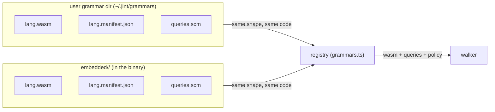
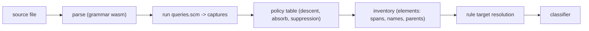

## What exists today

Ten grammars ship embedded in the binary: c, cpp, css, go, markdown, php, python, tsx,
typescript, verilog. Each lives in `packages/sdk/src/core/input/embedded/<lang>/` as three
artifacts: `<lang>.wasm` (parse), `<lang>.manifest.json` (facts: version, extensions, optional
policy), `queries.scm` (extraction patterns). The walker (`walk.ts`) parses with web-tree-sitter,
runs the grammar's compiled queries (`query.ts`), and materializes the inventory. It holds no
node-type names: the .scm assigns captures, the runtime sees only captures.

A user grammar dir (`$JINT_DIR/grammars`, default `~/.jint/grammars`) registers at lint start
through the same three-artifact shape; a user wasm wins over embedded for the same language, and a
manifest + queries.scm without a wasm shadows an embedded grammar's extraction. The registry table
(`grammars.ts`) is one line per grammar; the dirs stay pure data.

The parity corpora (`tests/fixtures/parity/`) pin the extraction per language; the ten-grammar
port and the dogfood run against main are complete. This branch IS the implementation.

## Decision

### Grammars are embedded and tool-owned (2026-10-14, embed verdict)

All ten grammars register through the compile-time embedded path. Size (linux-x64, gzip -9, the
release setting): four-grammar tar.gz 35.7 MB -> all-ten 36.9 MB, +1.25 MB (+3.3%) - raw delta
+24 MB, but wasms compress ~95% in the container. CI determinism buys the rest: the same commit
produces the same report, with no network, no registry, no version drift in the measurement path.

The why: the agent-authored field trials replaced the hypothetical bring-your-own-grammar user.
Ten real grammars went through trials, review rounds, and ported parity corpora; the vocabulary
grew through releases with two-language calibration (the is_filename_fitting precedent), never
by user minting. A user grammar dir stays the seam for the long tail, and it is the SAME three-file
shape as embedded - wasm + manifest + queries.scm - so the custom-grammar path exercises the
identical code the binary ships.

### Queries are the mapping (2026-10-15, query port)

The grammar's queries.scm IS the mapping - the nvim-treesitter tags.scm pattern. A pattern
captures a node with a jint-owned capture; the runtime turns matches into candidate elements. The
old declarative table's six adjustment fields collapse into pattern authoring plus one policy
table:

- **Span = captured node.** Absorb is pattern authoring: a wrapper that belongs to the element
  (ts export_statement, python decorated_definition, cpp template_declaration) is captured by the
  wrapper pattern. absorbTail (bytes of tail that still read as prefix-absorb: 2 for type and
  binding, swallowing a trailing `;`) is the only numeric policy.
- **Pattern order is priority.** Two patterns rooting on the same node type but assigning
  different captures resolve to the earlier pattern (c's prototype/state split depends on it).
  The validator demands an `; @priority` directive comment on every involved pattern; a pair
  without it fails the run at setup (SetupError naming the patterns and the fix).
- **Same-capture nesting is suppressed, outer wins** - a same-capture match inside an existing
  same-capture element reads as a wrapper's payload and collapses into it, unless the tail
  distance is real (a nested function with a body surfaces as a child). A selfNesting grammar
  (manifest fact; markdown) disables the collapse entirely - sections nest legitimately.
- **Per-noun descent is a POLICY table**, keyed by the outer capture, overridable per grammar in
  the manifest (`policy`, validated at load: capture keys or selfNesting). Of the ten, only
  markdown needed an override (`selfNesting: true`); every other grammar ships zero-config.
- **Honest absence over stretch.** A node type with no honest home in the vocabulary is not
  force-mapped; it is recorded as WAITING in the .scm comments and the parity README. Stretches
  poison the classifier frame.

#### The capture -> target table

| capture    | rule-side targets                | descent policy                                                                 | absorbTail | notes                                                                                                |
| ---------- | -------------------------------- | ------------------------------------------------------------------------------ | ---------- | ---------------------------------------------------------------------------------------------------- |
| @function  | functions, definitions           | opaque (nested same-capture units with real tail distance surface as children) | 0          | test call composites included via callee-predicated patterns (ts/tsx)                                |
| @type      | types, definitions               | show-through interiors                                                         | 2          | composite units: classes, structs, modules, md sections (selfNesting)                                |
| @binding   | bindings, definitions            | opaque                                                                         | 2          |                                                                                                      |
| @comment   | comments                         | terminate; never hides                                                         | 0          |                                                                                                      |
| @import    | imports                          | never hides                                                                    | 0          |                                                                                                      |
| @name      | (name source, not a target)      | -                                                                              | -          | binds the identifier/callee naming the element                                                       |
| @docstring | (ownership marker, not a target) | -                                                                              | -          | python string-in-block docstrings; projects into the comment kind on the wire, owned via docstringOf |

@comment, @import, and @docstring are LANES: never containers of elements, exempt from every
suppression rule, never hidden by an enclosing element.

#### The three target namespaces

A rule's target resolves over three namespaces, in order of breadth:

1. **file** - the whole file as one judgment unit. Exists for every file walked; grammar-
   independent. Target: `files`.
2. **capture** - the shared vocabulary. Singular names what one element IS (`function`);
   plural addresses the group a rule targets (`functions`, `definitions`, `comments`,
   `imports`). One implementation (`matchesTarget`) serves both selection tiers.
3. **node type** - one grammar's raw tree-sitter type, grammar-local, written `lang:node_type`
   when addressed, with no shared meaning across grammars. For rules that only ever judge one
   format.

Examples: `files` judges every file; `functions` resolves to every @function element across
all ten languages; a css-only rule addresses `css:rule_set` without forcing the node into the
shared vocabulary.

### Per-grammar summary

What each queries.scm captures, and its WAITING ledger (each .scm's comments are the source of
truth; the parity README holds the verdicts):

| grammar          | captures                                                                                  | WAITING                                                                         |
| ---------------- | ----------------------------------------------------------------------------------------- | ------------------------------------------------------------------------------- |
| typescript / tsx | functions, types, bindings, comments, imports; test call composites via callee predicates | text-name capture (test title strings)                                          |
| python           | functions, types, bindings, comments + @docstring (string-in-block)                       | assignments as bindings                                                         |
| go               | functions (+ methods), types, bindings (single-spec anchor pattern)                       | short_var_declaration inside functions (opaque interiors)                       |
| c                | functions (prototypes split from state by priority), types, bindings                      | field (struct/union members); macros are a grammar fact, not a gap              |
| cpp              | c plus classes, methods, template absorb                                                  | field, using/alias declarations; namespace is transit                           |
| php              | functions, methods, types, bindings (universal name node)                                 | closures, include/require, property (field), per-alias import split             |
| css              | comments only - decided policy                                                            | selector-rule, declaration-pair, @-statements (incl. imports: not code imports) |
| markdown         | sections (@type, selfNesting; heading text as name)                                       | prose, code-block, link_reference_definition; inline grammar parked             |
| verilog          | modules (@type), always/initial/final as @function (honest call), nets as bindings        | module/port/instance captures; packages/interfaces/programs                     |

## Rejections

| what                                                                                                                 | why                                                                                                                                                                                                                                                                             |
| -------------------------------------------------------------------------------------------------------------------- | ------------------------------------------------------------------------------------------------------------------------------------------------------------------------------------------------------------------------------------------------------------------------------- |
| Imperative defineGrammarExtraction (a TS extract function per grammar)                                               | grammar code diffs like prose; review must be read, not diffed; node-type strings in code are never checked. The escape hatch is queries-as-data, not TS                                                                                                                        |
| Declarative 4-field mapping table (defineGrammarMapping: kind -> role plus wrappers, names, descent)                 | contextual refinement (c prototypes, css value-position calls, php assignments, ts initializers) capped what a flat table can say - the tier-2 query signature kept appearing in our own tree; replaced by queries, the ecosystem's own language for alternation and predicates |
| Declared/minted user targets (grammars export custom nouns rules address)                                            | a double-judgment seam and a vocabulary-governance hole; vocabulary grows through releases, never user minting. Rule-side node-type addressing covers the format-specific tail                                                                                                  |
| JIT d.ts projection at run start (types generated from the grammar dir)                                              | a product choice, not a technical necessity, under agent authorship; ambient shims plus loud runtime validation suffice. Revisit trigger: a human writing rules in a checked editor                                                                                             |
| Stretches in the default mappings (md fenced_code_block -> function, css rule_set -> type, php closures -> function) | stretch mappings poison the classifier frame; honest absence plus a recorded WAITING beats a judged unit that lies about what it is                                                                                                                                             |
| graphify-style per-language extractors                                                                               | 37 hand-written walkers for 37 languages; our ten languages cost zero bespoke walk modules - the .scm plus one shared runtime                                                                                                                                                   |
| Fetch-on-demand grammar registry                                                                                     | dead on size: embedding all ten costs +1.25 MB gzipped, and fetching puts the network in the measurement path                                                                                                                                                                   |

## Definitions

- **capture** - the jint-owned shared noun a grammar's queries assign to a matched node; what
  one element IS. Glossary term; the frozen set and the @name seam live in `query.ts`.
- **pattern priority** - the earlier query pattern wins when two patterns assign different
  captures to the same node; load-bearing, therefore `; @priority`-validated.
- **absorbTail** - the largest wrapper tail in bytes that still reads as prefix-absorb (one
  logical element); a same-capture nest with a larger tail surfaces as a child.
- **lane** - a capture (@comment, @import, @docstring) that is never a container of elements and
  never hides: exempt from every suppression rule.
- **descent default** - the per-noun policy for what a captured element's interior yields
  (opaque vs show-through). Glossary term; the table lives in `query.ts`, overrides in the
  manifest.
- **selfNesting** - a manifest fact: same-capture candidates nest legitimately (markdown
  sections). Glossary term.

## Questions

### Open

#### Vocabulary growth ledger

Future embedded captures, release-gated with two-language calibration: prose and code-block
(markdown), field (c/cpp/php member data), module/port/instance (verilog), selector-rule and
declaration-pair (css), text-name capture (test title strings, md headings - a render name that
is not an identifier), and contextual refinement beyond one discriminator (today's predicates
cover c prototypes and ts call composites; deeper context still has no shape).

#### Zero-element legality enforcement

A comments-only css inventory is legal; so is an empty one (a stylesheet without comments).
Legality is per grammar and declarable today but not enforced; review round 3's verdict:
declared per-grammar legality, not a global net. Enforcement is unshipped.

#### Degraded-mode warning surfacing

A parse flagged hasError still yields exact elements for what parsed, and composite descent
skips degraded files silently (the php trial's realized gap). The runtime warning is ported;
surfacing it in the report is not.

#### .h routing

Both c and cpp claim `.h`; first registration wins, so cpp serves `.h` today. The default is
kept and documented, not specified further.

#### Grammar version-pin bump policy

Embedded grammars pin versions in their manifests. When to bump (grammar bugfix vs risk of
inventory churn) has no policy; the parity corpora make the churn visible when it happens.

### Settled

#### Transit vs mapping

Settled 2026-10-15: unlisted node types passthrough - a node no pattern captures yields nothing
and blocks nothing. The verilog trial confirmed it: the trial's two pure-plumbing descent
containers were absorbed by passthrough with no transit machinery at all, and six mapped kinds
produced the identical inventory. Fails open by design; the zero-element and degraded-mode
signals (both open above) are the counterweights.

#### Embed vs fetch

Settled 2026-10-14: embed everything. +1.25 MB gzipped measured on linux-x64; fetch-on-demand
is rejected above.

#### Fresh branch vs evolve the old walker

Settled 2026-10-15: fresh branch from main, old walker kept as the parity reference. The audit
verdict: the dying layer was the call-path middle (the node-kind table and its per-walker
machinery), not the walker's edges - so the reference walker ran live beside the port until the
dogfood gate (ten ports, then main-vs-branch on the same corpus: SHIP, no unexplained delta).

#### Test composites as functions

Settled 2026-10-15 (62e010f): jest/vitest call composites (describe/it/test and the before/after
family) capture as @function through callee-predicated patterns - a bare top-level call is not a
definition, the allowlisted family is. The old walker's stretch of every call composite to the
function noun is retired; the title string stays the WAITING text-name capture.

#### Markdown frontmatter

Settled 2026-10-15: frontmatter transits - no capture, minus_metadata subtracts it from the
judged surface.

#### MDX

Settled 2026-10-14: excluded (issue #9) - the grammar is immature; md covers the prose case.
