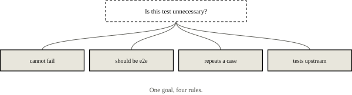
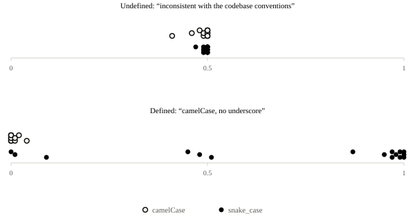
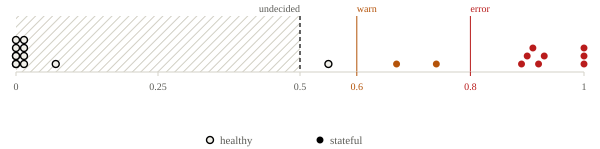
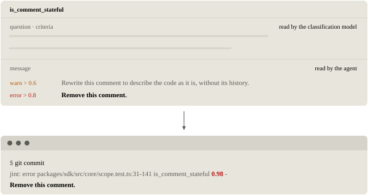

# Writing jint rules

Writing rules is not easy. Most rules fail when rule authors choose the wrong properties to
look for.
A given comment, for example, has many properties we need to analyze to classify
it as a bad one: statefulness, drift, narration, among other things.
This means that a single rule to catch errors is not sufficient.

## Start from the goal, but don't make it a rule

Achieving a goal like catching unnecessary unit tests is rarely done with a single rule.
"Is this test unnecessary?" means several properties: a test that
cannot fail, a test that should be e2e, a test that repeats another case or testing upstream
functionalities. Write one rule per property.

## Define the words you are using

Defining the elements of a classification within the criteria goes a long way.
If you hand a classification model a goal where the explicit properties of what you're asking are
not set, it will make the classification rely on the model's weights instead of what you're
looking for.

Put yourself
in the classifying model's perspective. Think _"what would I need to know to classify this myself"_?

"Is this naming inconsistent with the codebase conventions?" fails because "inconsistent" means a different thing to every reader,
and the model picks its own criteria.

## What a value means

A value is the model's probability that the answer is yes, the same number a language model uses
to choose its next word. 0.9 is a strong lean to yes and 0.1 a strong lean to no. 0.5 means the
model could not choose, so a value of 0.45 against 0.55 is not a ranking. Never set a threshold
below 0.5: a rule that fires there fires on answers that lean no.

## Messages

Classifying is only useful if your agent can act on it. This is why it's recommended to return a
message to your agent with instructions on how to proceed when a certain threshold is met.

Messages should be one sentence, with one action: "Remove this comment." Otherwise, the agent will
not know what to do with the classification result.

