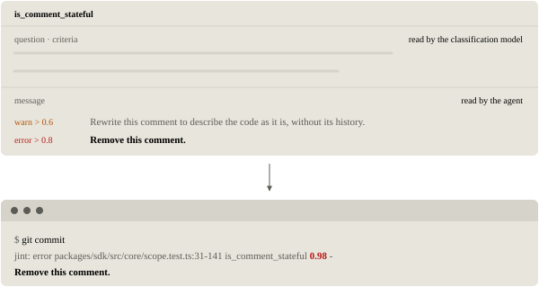

# What's jint?

jint is an **extensible** semantic linter. A tool to replace code reviews.

jint reads your files, asks a decision model questions about specific parts of your code that
you or your agent previously set, and steers your agent with the findings.

What you ask, the captured code and how to handle the result of the classification is embedded in
the shape of a traditional linter, as [rules](what-are-rules.md).

## Replacing code reviews

jint moves the code review to the implementing agent.

Developers use memory or skills to guide an agent from making mistakes and to guide its output.
Instead of guiding, we need to enforce and verify.

"This name says nothing." "This comment repeats the code." Each one is a steering prompt that
we can convert into a [rule](what-are-rules.md).

Instead of writing the same prompt a second time, write the rule instead.
The engineer's judgment becomes a rule.

If you use jint in a [pre-commit hook or in CI](how-to-use.md#pre-commit-and-ci), a violated rule
fails the hook, telling the agent what to fix. The agent corrects the code before a reviewer
sees it, so the output is correct from the start.

## Your agent runs jint

jint is meant to be run by your agent, not by you. The agent writes code, runs jint over it, reads
the findings, and fixes them before it hands the work back, allowing it to check its own work.

